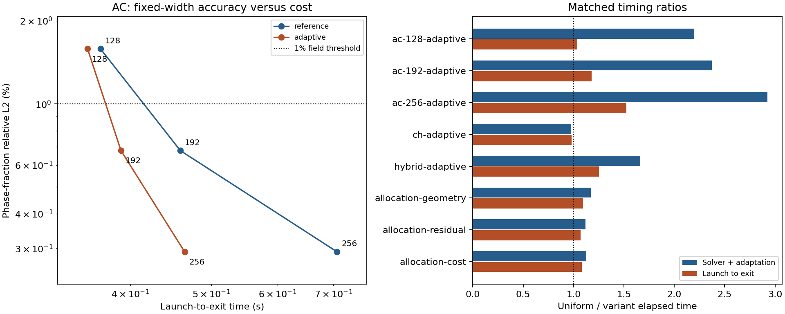
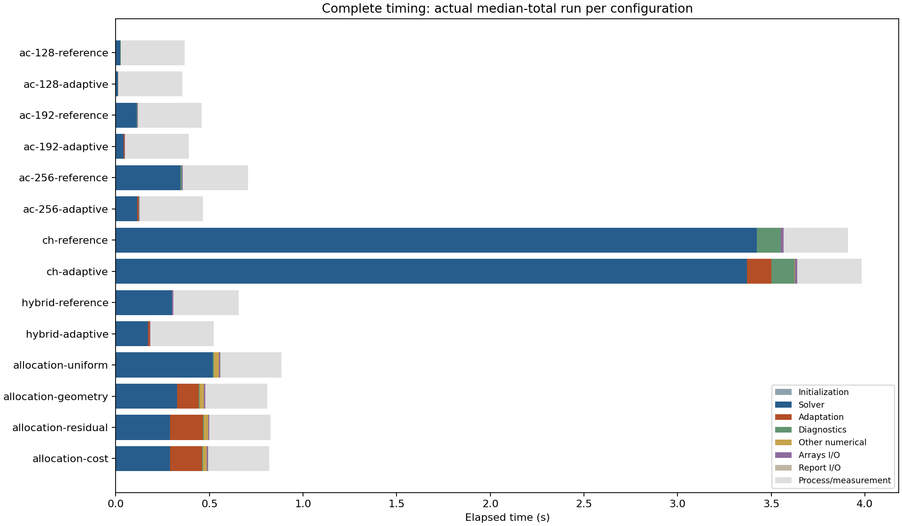

# Fresh performance measurements

Generated from summary.json. Interpret with ../../PERFORMANCE_PROTOCOL.md; three repetitions per configuration and one finer AC reference. Component medians need not add to the median total.

| Configuration | Evolution (s) | Launch–exit (s) | Range (s) | Final DOFs | Peak RSS (MiB) |
| --- | ---: | ---: | ---: | ---: | ---: |
| ac-128-reference | 0.024388 | 0.368218 | 0.3645–0.3733 | 16,384 | 77.25 |
| ac-128-adaptive | 0.011095 | 0.355354 | 0.3495–0.3581 | 4,900 | 76.91 |
| ac-192-reference | 0.110773 | 0.459010 | 0.4554–0.4597 | 36,864 | 79.98 |
| ac-192-adaptive | 0.046685 | 0.389656 | 0.3896–0.3922 | 10,816 | 81.52 |
| ac-256-reference | 0.344360 | 0.707030 | 0.7016–0.7120 | 65,536 | 84.12 |
| ac-256-adaptive | 0.117784 | 0.464432 | 0.4587–0.4680 | 16,900 | 84.80 |
| ch-default-reference | 3.419302 | 3.909660 | 3.8588–3.9348 | 16,384 | 82.95 |
| ch-default-adaptive | 3.500059 | 3.982787 | 3.9641–4.0191 | 16,384 | 82.86 |
| hybrid-default-reference | 0.297499 | 0.656181 | 0.6507–0.6611 | 32,770 | 81.42 |
| hybrid-default-adaptive | 0.178839 | 0.523215 | 0.5225–0.5263 | 12,170 | 82.39 |
| allocation-default-uniform | 0.516248 | 0.885361 | 0.8777–0.8954 | 73,730 | 91.66 |
| allocation-default-geometry | 0.441036 | 0.808874 | 0.7991–0.8125 | 35,380 | 97.16 |
| allocation-default-residual | 0.462025 | 0.826161 | 0.8230–0.8269 | 31,746 | 96.44 |
| allocation-default-cost | 0.459002 | 0.819591 | 0.8152–0.8329 | 31,746 | 96.44 |

| Variant | Evolution ratio | Launch–exit ratio | DOF ratio | Native energy discrepancy |
| --- | ---: | ---: | ---: | ---: |
| ac-128-adaptive | 2.198 | 1.036 | 3.344 | 5.008e-14 |
| ac-192-adaptive | 2.373 | 1.178 | 3.408 | 3.675e-14 |
| ac-256-adaptive | 2.924 | 1.522 | 3.878 | 3.080e-11 |
| ch-default-adaptive | 0.977 | 0.982 | 1.000 | 0.000e+00 |
| hybrid-default-adaptive | 1.664 | 1.254 | 2.693 | 2.709e-10 |
| allocation-default-geometry | 1.171 | 1.095 | 2.084 | 4.377e-11 |
| allocation-default-residual | 1.117 | 1.072 | 2.322 | 6.070e-08 |
| allocation-default-cost | 1.125 | 1.080 | 2.322 | 6.070e-08 |

| AC configuration | Phase-fraction relative L2 | Radius error | Native energy error | All accuracy gates |
| --- | ---: | ---: | ---: | --- |
| ac-128-reference | 0.0158284 | 0.0440313 | 0.00927021 | False |
| ac-128-adaptive | 0.0158284 | 0.0440313 | 0.00927021 | False |
| ac-192-reference | 0.0067751 | 0.0168936 | 0.00358982 | True |
| ac-192-adaptive | 0.0067751 | 0.0168936 | 0.00358982 | True |
| ac-256-reference | 0.00291442 | 0.00813381 | 0.00174628 | True |
| ac-256-adaptive | 0.00291442 | 0.00813381 | 0.00174628 | True |

Solver iteration counters are unavailable where the source reports only accepted steps. No iteration count of zero is inferred. The complete raw reports retain conservation/energy checks, transfer events and model parameters.

